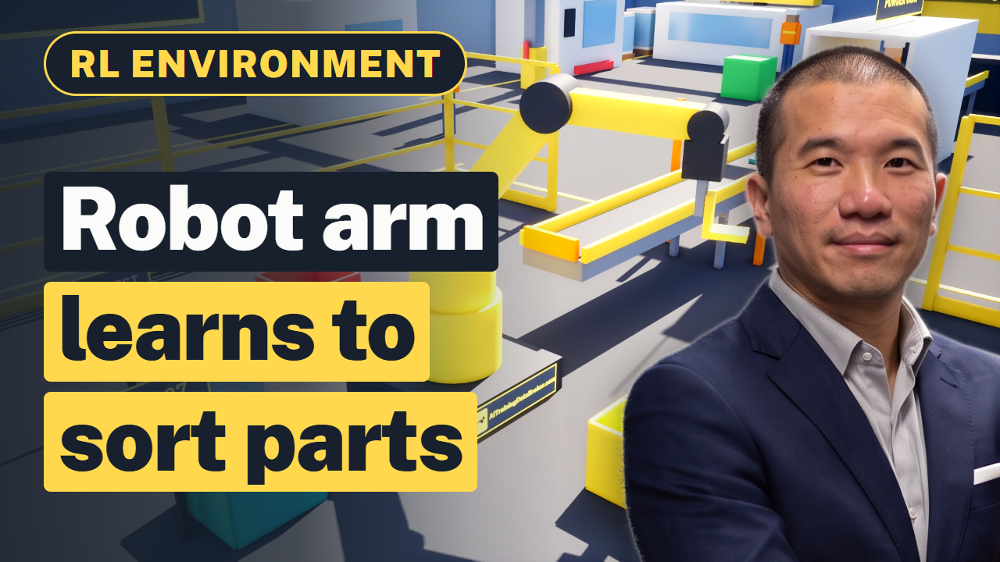

# Manufacturing RL Environment in Unreal Engine: Robot Arm Bin Picking Demo

A factory robot arm learns, by trial and error, to sort 3 kinds of steel bracket into the right bins. First pick: the bracket hits the floor. After practice: 3 bins, 0 drops.

This is an open **manufacturing reinforcement learning (RL) environment** built in **Unreal Engine 5**: a six-axis style robot arm sorting brackets
practises one job, every try is scored by a reward function, and the score teaches it what works. It covers
robot arm bin picking, part sorting, inverse kinematics and robot cell simulation. The full walkthrough is on YouTube ([Manufacturing/Factory AI RL Environment (Robot Arm Demo & Unreal Engine)](https://www.youtube.com/watch?v=YyOVTxhzDBQ)), and the
[slides with the full transcript](https://aitrainingdatabroker.com/slides/rl-environment-factory-robot-arm-manufacturing/?utm_source=github&utm_campaign=rl-environment-factory-robot-arm-unreal) explain each step in plain words.

## What is an RL environment?

Reinforcement learning means software learns a job by trying, and every try gets a score. An RL environment is the
practice world where those tries happen: a task, many tries, and a reward function that grades each one. When the
world copies a real place closely enough, people also call it a digital twin or a simulator.

## The world

A bracket line: a press brake, a powder-coat tunnel, a conveyor, a robot cell with a CAD screen, part bins A-12, B-07 and C-30, a reject bin, forklifts, shelving and workers.

## Reward function

| Event | Score |
|---|---|
| Clean grip and right bin | points |
| Bracket lands in its bin | +20 |
| Dropped part | -30 |
| Wrong bin | -20 |
| Slow pick | small cost |

## How it was built

The arm is a chain of pivots (turret, shoulder, elbow, wrist, fingers). `gen_factory.py` solves its inverse kinematics for every pick (link lengths 130 and 110 cm, gripper kept pointing down) and moves each bracket with the gripper, or lets it fall.

The run is pre-programmed on a Sequencer timeline (`LS_Factory`) and rendered with Unreal's built-in sequence capture.
The scorecard is drawn afterwards in Python, so a text fix never needs a re-render.

## Why manufacturing companies build RL environments

A private simulator lets a company practise a costly or risky job without touching real equipment: teaching a robot cell a new part overnight, testing a changeover before the line stops, and cutting scrap.
What makes a simulator realistic is the company's own operating data: CAD drawings, handling logs, and quality and scrap records. That data can stay in-house
to train a private model, or be licensed to an AI lab after it is de-identified, with the contract setting the limits.
How that works for manufacturers is explained at [AITrainingDataBroker.com](https://aitrainingdatabroker.com/sell/manufacturers/?utm_source=github&utm_campaign=rl-environment-factory-robot-arm-unreal).

## Quick start

1. Install Unreal Engine 5.8 from the Epic Games launcher and open `FactoryRL.uproject`.
2. The project opens on `/Game/Factory/Lvl_Factory`. Open `Content/Factory/Film/LS_Factory` in Sequencer and press play.
3. To render it yourself, edit the paths at the top of `scripts/render.py` and run `python scripts/render.py preview`, then `full`.
   `scripts/overlay_*.py` draws the scorecard and cuts the clips with ffmpeg.

Everything in the world is built from Unreal Engine's basic shapes and our own materials (50 Unreal files),
so it opens without Marketplace packs or template content.

## More RL environment demos

- [Trucking RL Environment in Unreal Engine: Trailer Docking Demo](https://github.com/aitrainingdatabroker/rl-environment-trucking-trailer-docking-unreal)
- [Construction RL Environment in Unreal Engine: Tower Crane Lift Demo](https://github.com/aitrainingdatabroker/rl-environment-tower-crane-construction-unreal)
- [MLP in RL, Explained with a Grocery Store: Milk Reorder Demo in Unreal Engine](https://github.com/aitrainingdatabroker/mlp-rl-grocery-reorder-unreal)
- [Delivery Robot RL Environment in Unreal Engine: Sidewalk Pizza Delivery Demo](https://github.com/aitrainingdatabroker/rl-environment-delivery-robot-unreal)

## About

Made by [AI Training Data Broker](https://aitrainingdatabroker.com/?utm_source=github&utm_campaign=rl-environment-factory-robot-arm-unreal), a broker and technical advisor for companies licensing their
operating data to AI labs. Code and our own assets are MIT licensed (see `LICENSE`). The world is a demo built for
illustration: a production RL environment needs more training, testing and real operational data. General information,
not legal advice.
